# AWS Cloud Storage: S3 Bucket Versioning, Web Hosting & Lifecycle Management

## Table of Contents
- [Introduction to Cloud Object Storage](#-introduction-to-cloud-object-storage)
- [Project Overview](#-project-overview)
- [Objective](#-objective)
- [System Specifications & Storage Baseline](#️-system-specifications--storage-baseline)
- [Storage & Versioning Architecture (ASCII Flowchart)](#-storage--versioning-architecture)
- [Deployment Methodology](#-deployment-methodology)
  - [Phase 1: MFA-Secured Root Authentication & S3 Dashboard Access](#phase-1-mfa-secured-root-authentication--s3-dashboard-access)
  - [Phase 2: S3 Bucket Architecture & Access Control Setup](#phase-2-s3-bucket-architecture--access-control-setup)
  - [Phase 3: Object Versioning & Server-Side Encryption Configuration](#phase-3-object-versioning--server-side-encryption-configuration)
  - [Phase 4: Asset Upload & Browser Endpoint Verification](#phase-4-asset-upload--browser-endpoint-verification)
  - [Phase 5: Document Iteration & Multi-Version Object Tracking](#phase-5-document-iteration--multi-version-object-tracking)
  - [Phase 6: Multi-Stage Object Purge & Safe Bucket Deletion](#phase-6-multi-stage-object-purge--safe-bucket-deletion)
- [Operational Relevance & Storage Governance](#-operational-relevance--storage-governance)
- [Ethical Guidelines & Disclaimer](#️-ethical-guidelines--disclaimer)

---

## Introduction to Cloud Object Storage
**Amazon Simple Storage Service (Amazon S3)** is an object storage service offering industry-leading scalability, data availability, security, and performance. Unlike traditional file systems (which store files in hierarchical folder trees) or block storage (like Amazon EBS, which attaches to virtual machines), S3 stores data as discrete objects identified by unique keys inside flat containers called **buckets**.

A foundational feature of S3 is **Bucket Versioning**. Versioning keeps multiple variants of an object in the same bucket. When enabled, S3 generates a unique Version ID every time a file with the same key name is overwritten or uploaded. This provides built-in protection against accidental overwrites, inadvertent deletions, and malicious data tampering.

## Project Overview
This project documents the complete lifecycle of an AWS S3 bucket. Using the **AWS Management Console**, a general-purpose bucket is created in the `us-west-2` (Oregon) region with Object Versioning enabled and public access settings configured[cite: 152, 154, 155]. 

The lab walks through uploading web and graphic assets, verifying in-browser rendering via presigned S3 URLs, committing multiple revisions of an `index.html` file to analyze the underlying version stack, and executing the mandatory multi-stage deletion process (emptying all versioned objects before terminating the container)[cite: 153, 164, 166, 167, 170, 172, 173].

## Objective
To configure, test, inspect, and safely decommission an Amazon S3 storage container, demonstrating:
1. Multi-factor authenticated console access to storage control planes[cite: 147].
2. Bucket provisioning with default server-side encryption (SSE-S3)[cite: 152, 156].
3. Enabling and validating Object Versioning across repeated file commits[cite: 155, 166, 167].
4. Serving static web content and diagram assets over HTTP/HTTPS[cite: 153, 165, 168].
5. Understanding S3 deletion safeguards and executing safe resource teardown[cite: 163, 170, 171, 173].

## System Specifications & Storage Baseline
* **Cloud Platform:** Amazon Web Services (AWS)[cite: 144, 150]
* **Target Region:** `us-west-2` (US West - Oregon)[cite: 152]
* **Bucket Type:** General purpose (multi-AZ redundant object storage)[cite: 152]
* **Storage Class:** S3 Standard[cite: 162, 164]
* **Object Ownership:** ACLs disabled (Bucket Owner Enforced)[cite: 143]
* **Default Encryption:** Server-Side Encryption with Amazon S3 managed keys (SSE-S3)[cite: 156]
* **Bucket Key:** Enabled (reduces KMS request volume)[cite: 156]
* **Bucket Versioning:** Enabled[cite: 155]
* **Staged Artifacts:**
  * `index.html` (Baseline webpage: 145.0 B -> Updated cyber attack infographic version: 1.9 KB)[cite: 164, 166, 167]
  * `Type-of-Computer-Network.jpg` (Network topology diagram: 435.3 KB)[cite: 162]
  * `1712250288886.png` (Threat infographic asset: 78.8 KB)[cite: 167]

---

## Storage & Versioning Architecture

```text
+----------------------------------------------------------------------------------------------------+
|                                AWS S3 BUCKET LIFECYCLE ARCHITECTURE                                |
+----------------------------------------------------------------------------------------------------+

                          [ AWS Root / IAM Management Console ]
                                            |
                                  (1) MFA Authenticated
                                            |
                                            v
                            +-------------------------------+
                            |   Amazon S3 Service Engine    |
                            +---------------+---------------+
                                            |
                                            |-- (2) Provisions Bucket: General Purpose
                                            |-- (3) Sets SSE-S3 Encryption & Bucket Key
                                            |-- (4) Enables Bucket Versioning
                                            |
                                            v
+----------------------------------------------------------------------------------------------------+
| S3 Bucket Container: pratiksha-27 (Region: us-west-2)[cite: 152, 158]                                             |
|                                                                                                    |
|  +----------------------------------------------------------------------------------------------+  |
|  | OBJECT REVISION STACK (Key: index.html)[cite: 166, 167]                                                     |
|  |                                                                                              |  |
|  |  [Version 3 (Latest)] -> Version ID: RDsnqwDviB70JMosuSrmkdon9aNQ4HLe (1.9 KB)[cite: 167]               |
|  |                          Contains: "Types of Cyber Attacks" Diagram[cite: 168]                        |
|  |                                                                                              |  |
|  |  [Version 2 (Historic)] -> Version ID: FOPeau4W7Y1VnV9lyBdpk3jkc3oLPIWN (1.9 KB)[cite: 166, 167]            |
|  |                            Intermediate revision preserved under stack                       |  |
|  |                                                                                              |  |
|  |  [Version 1 (Initial)]  -> Version ID: tQ0kHgf3rcna4YtBYvyH6ZY2wWNQf_AB (145.0 B)[cite: 166, 167]           |
|  |                            Contains: Baseline Webpage Header[cite: 164, 165]                                  |
|  +----------------------------------------------------------------------------------------------+  |
|                                                                                                    |
|  +----------------------------------------------------------------------------------------------+  |
|  | STATIC ASSETS INVENTORY[cite: 166, 167]                                                                     |
|  | - Type-of-Computer-Network.jpg (435.3 KB)[cite: 162]                                                     |
|  | - 1712250288886.png (78.8 KB)[cite: 167]                                                                |
|  +----------------------------------------------------------------------------------------------+  |
+----------------------------------------------------------------------------------------------------+
                                            |
                        +-------------------+-------------------+
                        |                                       |
                        v                                       v
         [ In-Browser Public Endpoint ]             [ Resource Decommissioning ]
         - Renders Presigned Image[cite: 153]                 - Empty: Purge 5 Objects (518 KB)[cite: 170, 171]
         - Renders Webpage & Infographic[cite: 165, 168]       - Delete: Final Bucket Termination[cite: 163, 173]
```

---

## 🚀 Deployment Methodology

### Phase 1: MFA-Secured Root Authentication & S3 Dashboard Access

Navigated to the AWS Management Console landing page (`aws.amazon.com/console`) and selected **Sign in**[cite: 144].
<br>


Selected the **Root user** radio button and entered the account root email address[cite: 145].
<br>

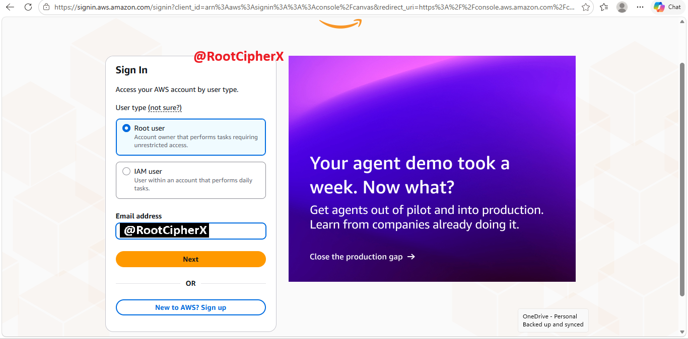

Supplied the root master password[cite: 146].
<br>

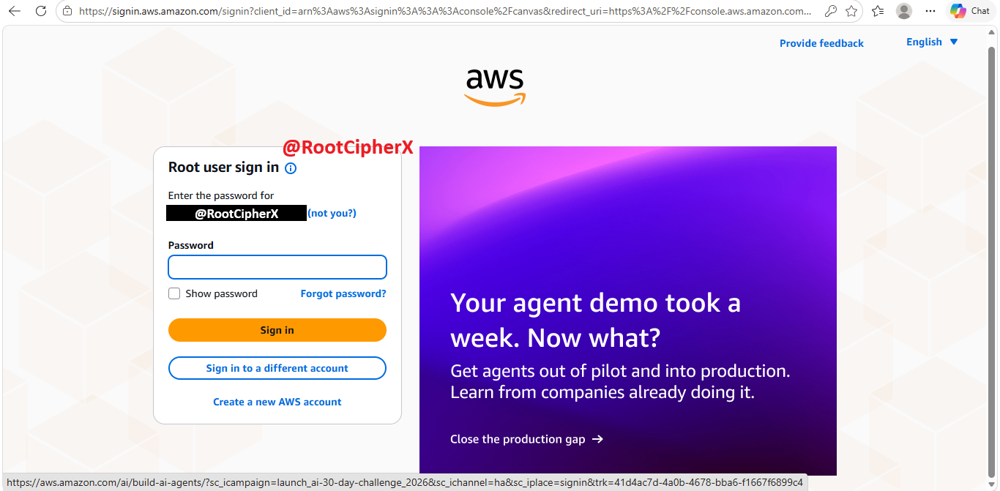

Encountered the mandatory **Additional verification required** challenge and entered the dynamic 6-digit TOTP code (`189148`) from Google Authenticator[cite: 147].
<br>

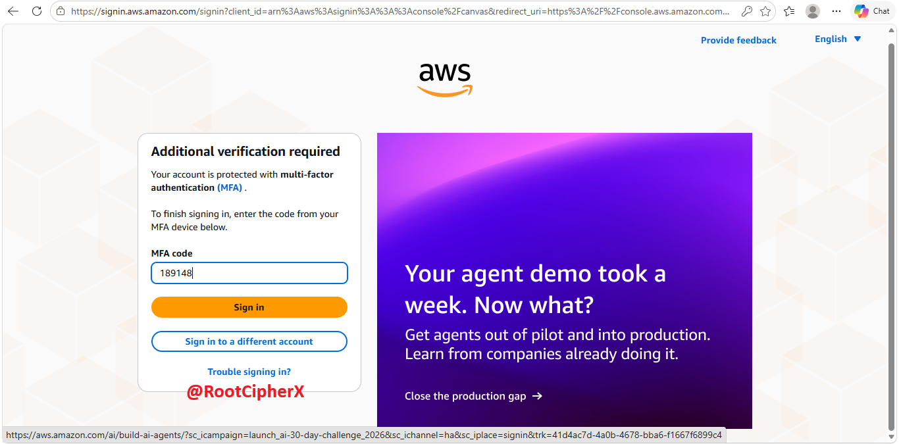

Completed the visual security CAPTCHA verification (`4t4hsh`) to authenticate the session[cite: 148].
<br>

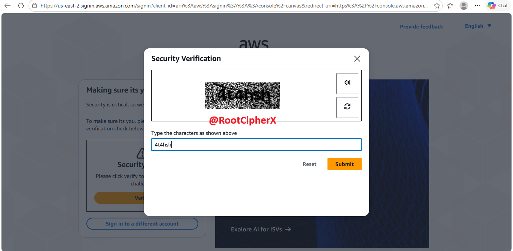

Authenticated into **Console Home** in the `us-west-2` (Oregon) region[cite: 149].
<br>

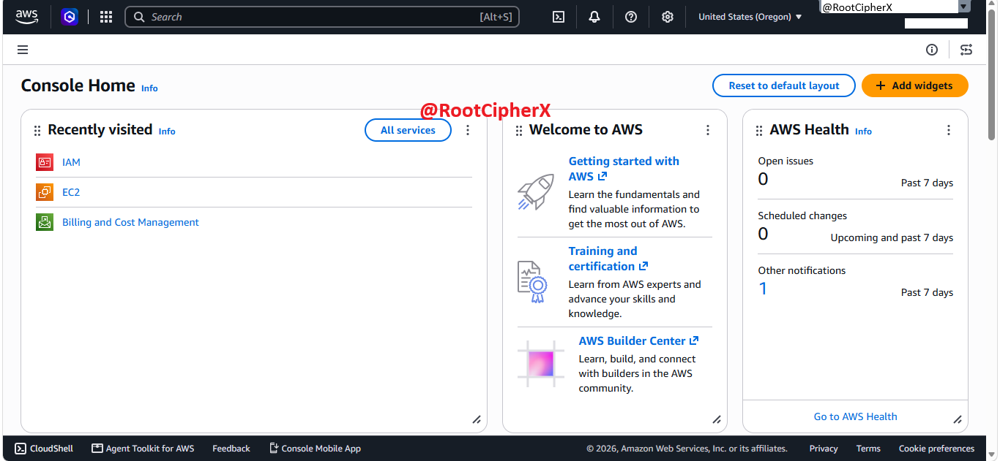

Searched for **S3** in the global navigation bar and opened the Simple Storage Service console[cite: 150].
<br>

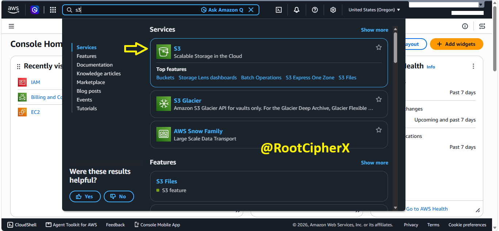

Landed on the Amazon S3 overview page and clicked **Create bucket**[cite: 151].
<br>

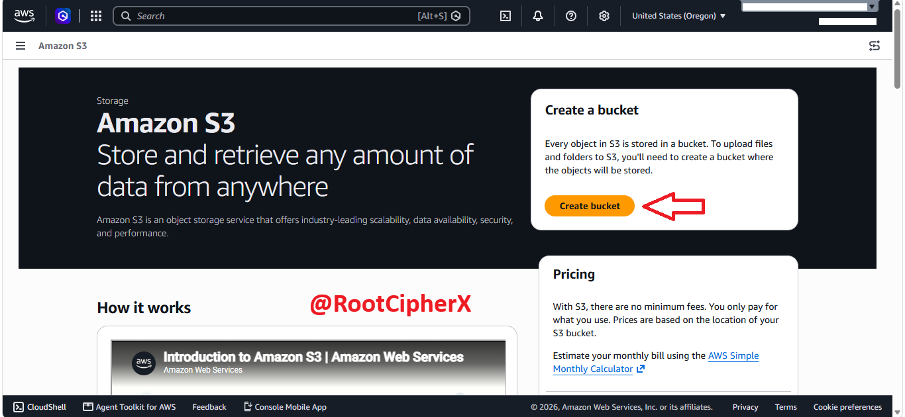

---

### Phase 2: S3 Bucket Architecture & Access Control Setup

Under **General configuration**, configured container parameters:
* **AWS Region:** `us-west-2` (US West - Oregon)
* **Bucket type:** `General purpose` (replicates data across a minimum of three Availability Zones)
* **Bucket namespace:** `Global namespace`
* **Bucket name:** Configured a globally unique bucket name (`pratiksha-27`)
<br>

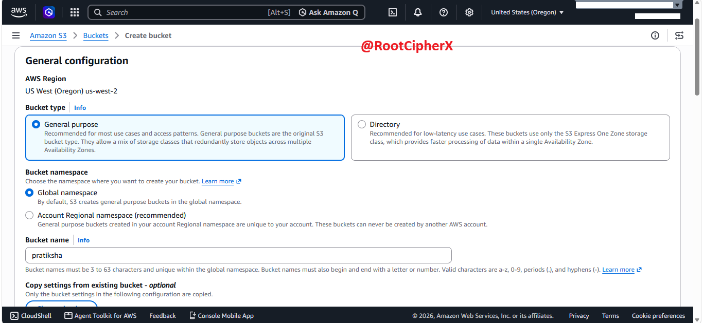

Under **Object Ownership**, selected **ACLs disabled (recommended)** to ensure Bucket Owner Enforced security.
<br>

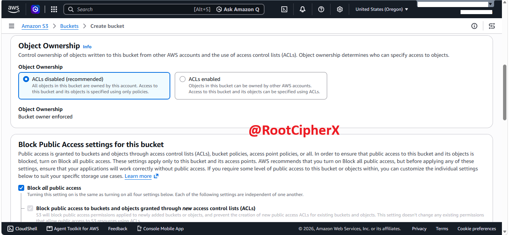

Under **Block Public Access settings for this bucket**, unchecked **Block *all* public access** and acknowledged the warning box to allow static website hosting and asset delivery.
<br>

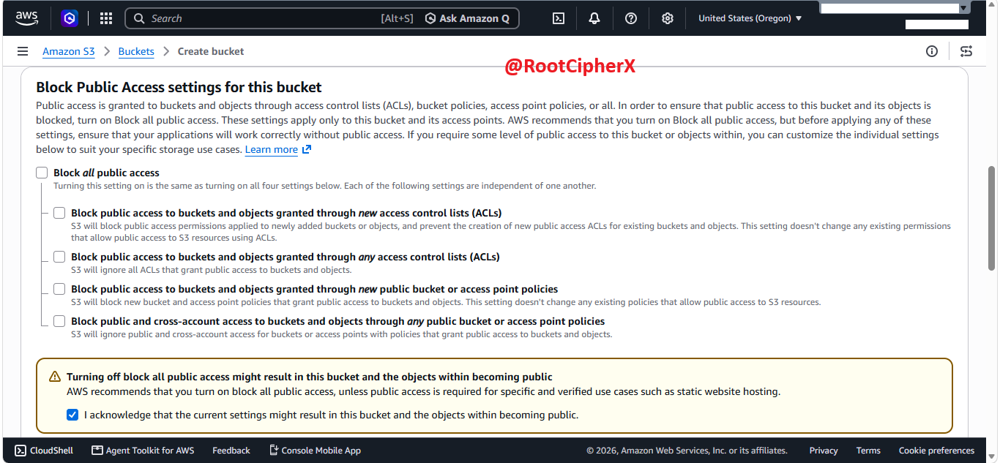

---

### Phase 3: Object Versioning & Server-Side Encryption Configuration

Under **Bucket Versioning**, selected **Enable** to preserve, retrieve, and restore every version of every object stored in the bucket.
<br>

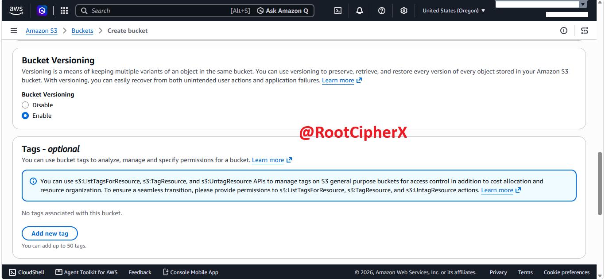

Under **Default encryption**, verified server-side encryption was configured with Amazon S3 managed keys (**SSE-S3**) and enabled **Bucket Key** to optimize encryption cost.
<br>

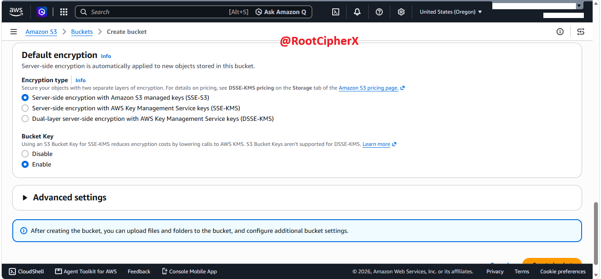

Under **Advanced settings**, verified **Object Lock** remained disabled and clicked **Create bucket**.
<br>

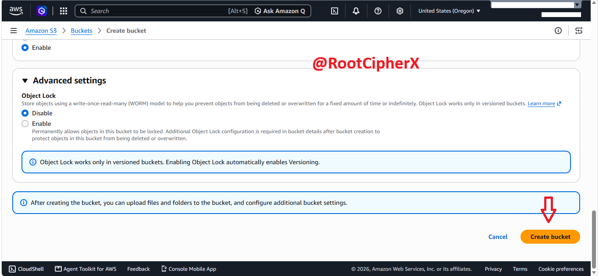

The console confirmed instantiation with a success banner: *"Successfully created bucket"*[cite: 158]. The bucket opened with 0 objects[cite: 158].
<br>

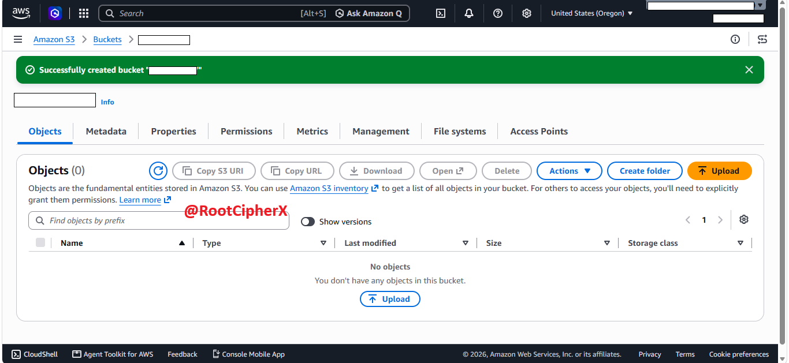

---

### Phase 4: Asset Upload & Browser Endpoint Verification

Clicked **Upload** to open the object staging interface[cite: 158, 159].
<br>

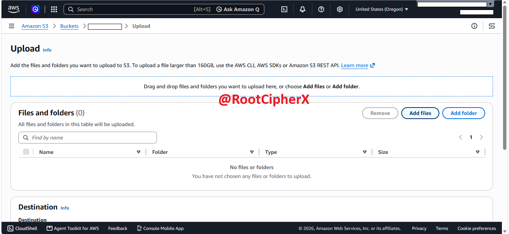

Clicked **Add files**, selected the initial networking diagram (`Type-of-Computer-Network.jpg`), verified the target destination URI (`s3://pratiksha-27`), and clicked **Upload**[cite: 160, 162].
<br>

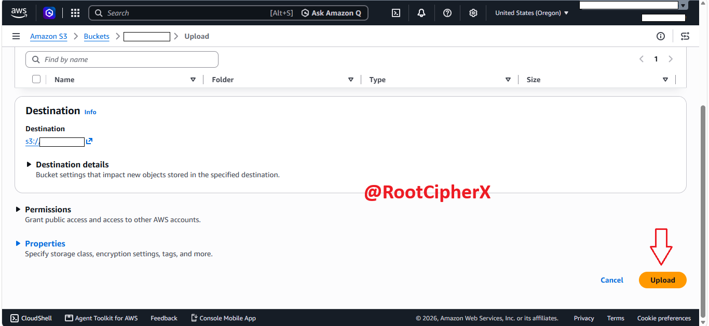

Received upload confirmation: *"Upload succeeded - 1 file, 435.3 KB (100.00%)"*[cite: 161].
<br>

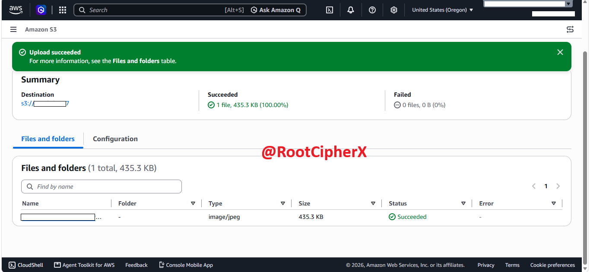

Inspected the **Objects** table, confirming `Type-of-Computer-Network.jpg` was indexed under the S3 Standard storage tier[cite: 162].
<br>

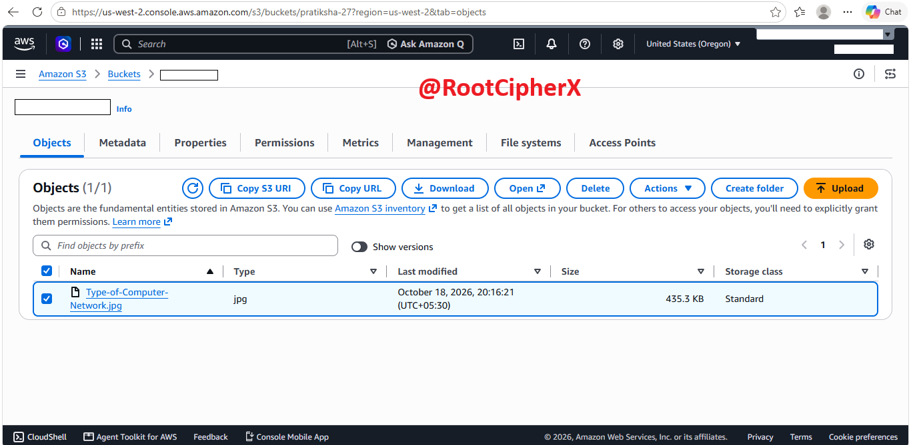

Selected the object and clicked **Open**[cite: 162]. AWS generated a secure presigned URL (`.s3.us-west-2.amazonaws.com`), and the browser rendered the networking diagram (LAN, WAN, MAN, CAN, HAN)[cite: 153].
<br>


Uploaded the baseline `index.html` document (145.0 B) into the bucket root[cite: 164].
<br>

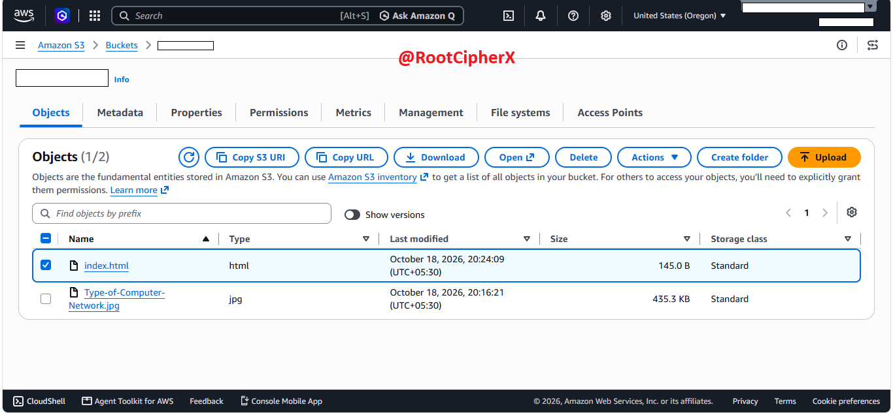

Opened `index.html` in the browser, verifying the initial header output:
> **Welcome To My S3 Webpage @RootCipherX**[cite: 165]
<br>

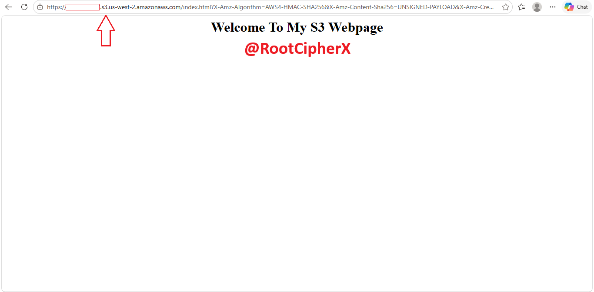

---

### Phase 5: Document Iteration & Multi-Version Object Tracking

Uploaded an updated revision of `index.html` (1.9 KB) referencing the image asset[cite: 166]. Toggled the **Show versions** switch to inspect the version stack[cite: 166]:
* **Latest Version:** Version ID `FOPeau4W7Y1VnV9lyBdpk3jkc3oLPIWN` (1.9 KB)[cite: 166]
* **Historic Version:** Version ID `tQ0kHgf3rcna4YtBYvyH6ZY2wWNQf_AB` (145.0 B) preserved underneath[cite: 166]
<br>

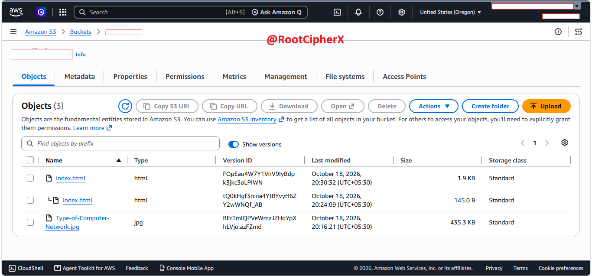

Uploaded a second infographic image (`1712250288886.png`, 78.8 KB) and committed a third version of `index.html` (1.9 KB)[cite: 167]. The bucket tracked all 5 distinct object iterations simultaneously[cite: 167]:
* `index.html` (Latest: `RDsnqwDviB70JMosuSrmkdon9aNQ4HLe`)[cite: 167]
* `index.html` (Previous: `FOPeau4W7Y1VnV9lyBdpk3jkc3oLPIWN`)[cite: 167]
* `index.html` (Original: `tQ0kHgf3rcna4YtBYvyH6ZY2wWNQf_AB`)[cite: 167]
* `1712250288886.png` (Asset: `gaZrsphUlB3jNhpT4h2qaWVbTsKzgOhP`)[cite: 167]
* `Type-of-Computer-Network.jpg` (Asset: `BErTmIQPVeWmzJZHqYpXhLVjo.azFZmd`)[cite: 167]
<br>

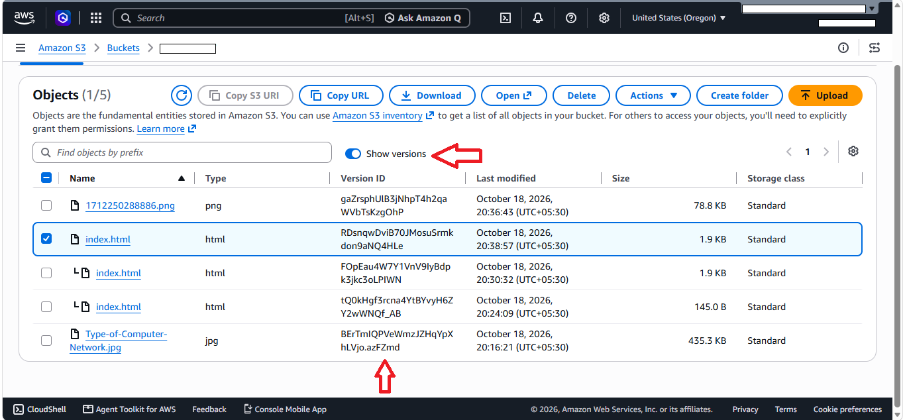

Refreshed the browser endpoint for `index.html`, verifying the updated DOM layout displaying the **Types of Cyber Attacks** diagram[cite: 168].
<br>

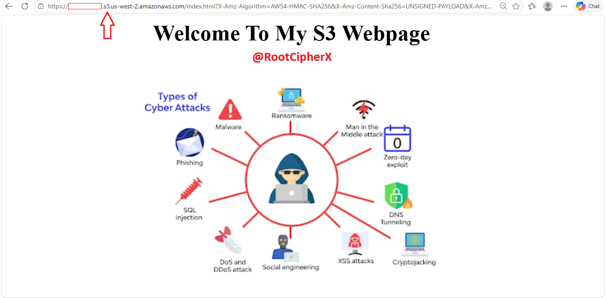

---

### Phase 6: Multi-Stage Object Purge & Safe Bucket Deletion

To prevent accidental data loss, AWS forbids deleting a bucket that contains active or versioned objects. Navigated back to the master **Buckets** catalog, selected the bucket, and clicked **Empty**[cite: 169].
<br>

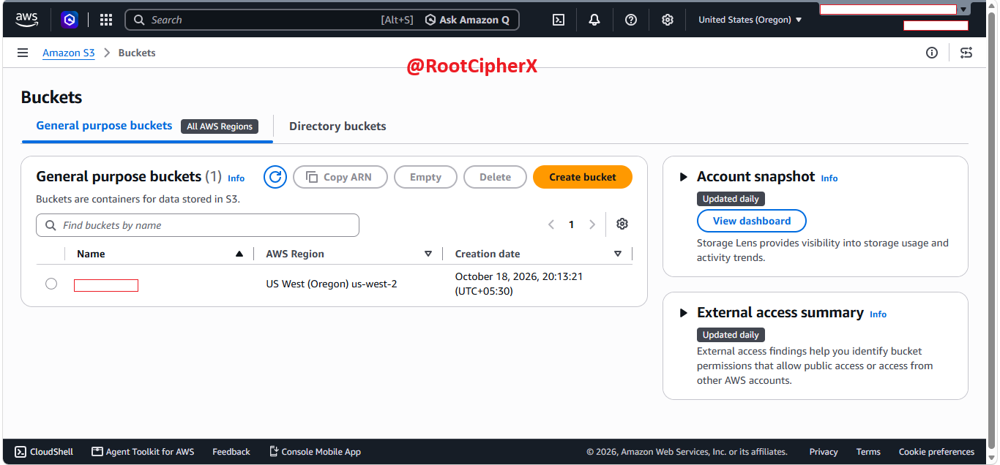

To satisfy the safety confirmation challenge, typed `"permanently delete"` into the text field and clicked **Empty**[cite: 170].
<br>

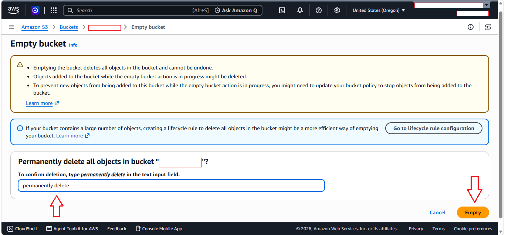

Received confirmation: *"Successfully emptied bucket"*[cite: 171]. All 5 objects (totaling 518.0 KB across all versions) were permanently purged[cite: 171]. Clicked **Exit**[cite: 171].
<br>

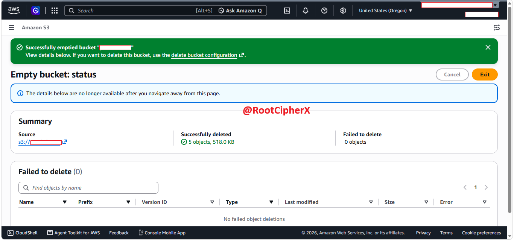

Selected the empty bucket in the catalog and clicked **Delete**[cite: 172].
<br>

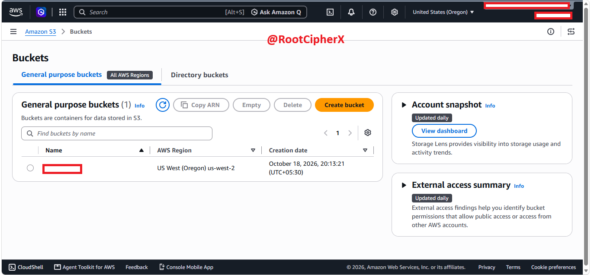

Reviewed the final deletion prompt, entered the bucket name into the confirmation field, and clicked **Delete bucket**[cite: 163].
<br>

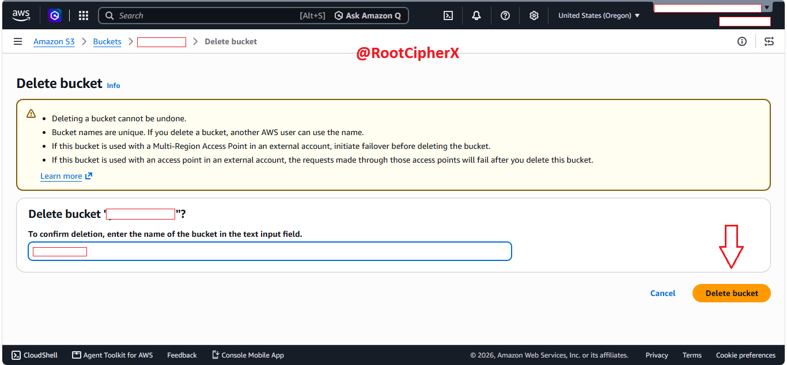

Received the final confirmation banner: *"Successfully deleted bucket"*[cite: 173]. The S3 console returned to a clean baseline showing **0 General purpose buckets**, eliminating any ongoing storage costs[cite: 173].
<br>

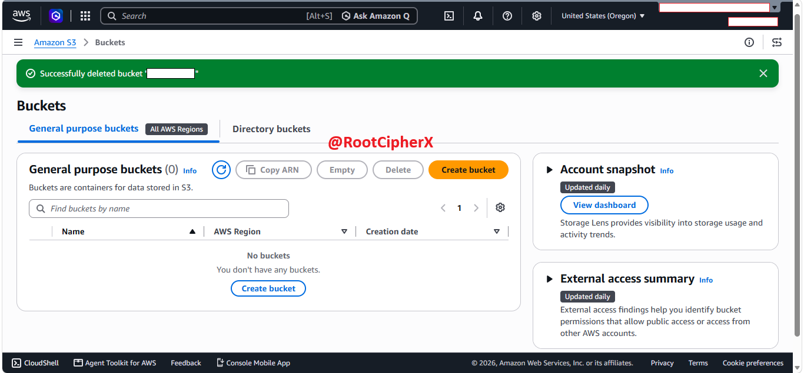

---

## Operational Relevance & Storage Governance

This deployment illustrates critical principles of enterprise cloud storage:

* **Object Versioning Protection:** In production, versioning safeguards against ransomware, accidental mass deletions, and application deployment bugs[cite: 155]. Even if an object is "deleted" by an application, S3 simply places a reversible *delete marker* on top of the stack rather than destroying the data.
* **Deletion Safeguards & WORM Compliance:** AWS strictly requires buckets to be completely emptied—including all noncurrent version IDs and delete markers—before a bucket can be destroyed[cite: 170, 171, 172]. For compliance workloads requiring immutability (SEC Rule 17a-4), **S3 Object Lock** can be layered on top to prevent even root users from deleting data during a retention period[cite: 157].
* **Cost & Lifecycle Hygiene:** While versioning preserves historic data, keeping old revisions indefinitely incurs ongoing storage costs[cite: 155, 171]. In production, teams pair versioning with **S3 Lifecycle Rules** to automatically transition noncurrent versions to lower-cost tiers (like S3 Glacier Flexible Retrieval) or expire them after a defined retention window (e.g., 90 days)[cite: 170].

---

## Ethical Guidelines & Disclaimer
This lab was completed within an authorized personal Amazon Web Services account strictly for cloud systems administration, storage versioning verification, and educational purposes. All objects and storage buckets were safely decommissioned and deleted following validation to maintain optimal account hygiene and avoid unexpected charges[cite: 170, 171, 173].
